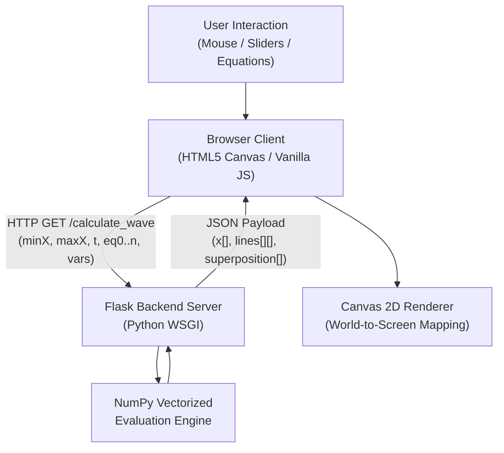
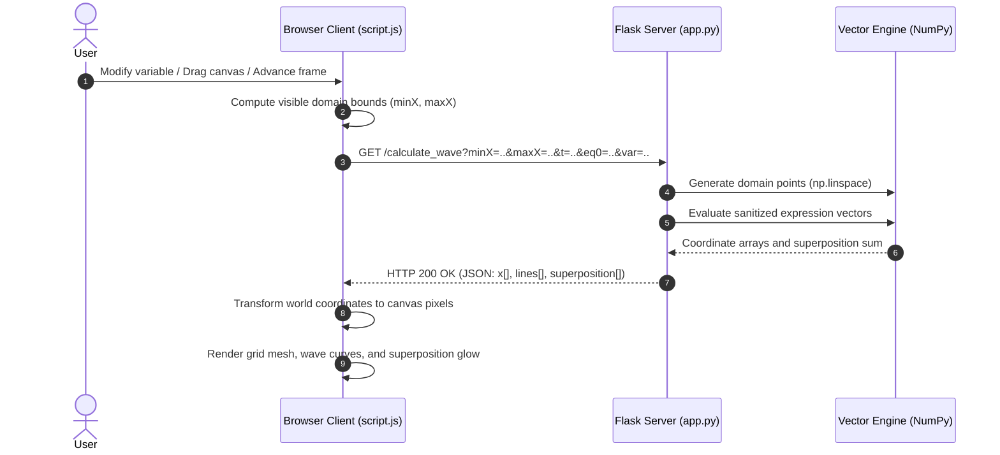

# Architecture and Design

This document details the architectural design, component responsibilities, data flow, and mathematical coordinate transformations utilized by GitPatch Wave.

## System Overview

GitPatch Wave employs a hybrid client-server architecture designed for local real-time mathematical exploration and physics wave visualization. The frontend provides interactive canvas rendering, slider controls, and responsive UI components. The backend evaluates mathematical functions across discrete intervals using NumPy vectorized operations.

## Component Architecture

### 1. Presentation Layer (Frontend)

- **Entry Point (`templates/intro.html`)**: Ambient introduction screen featuring a procedural animated starfield and an interactive glowing cursor particle trail.
- **Plotter Workspace (`templates/index.html`)**: Two-column layout comprising a parameter control sidebar and a full-height interactive HTML5 Canvas.
- **Client Controller (`static/script.js`)**:
  - Manages application state: view offsets, zoom scales, active equations, and parameters.
  - Handles user interactions: panning (drag), zooming (scroll wheel), equation addition/removal, parameter updates.
  - Implements an asynchronous rendering loop via `requestAnimationFrame` for continuous time animation (`Live Exec`).
  - Converts normalized wave data into screen coordinates and executes dual-pass drawing (individual stroked paths followed by glowing superposition composite).

### 2. Application Layer (Backend)

- **Application Controller (`app.py`)**:
  - Initializes Flask application instance with dynamic asset paths.
  - Resolves resource paths for both local development and frozen PyInstaller single-file bundles.
  - Exposes endpoints: `/` (Intro), `/plotter` (Main UI), and `/calculate_wave` (Computation API).
  - Provides configurable network binding via `HOST` and `PORT` environment variables with headless execution control via `NO_BROWSER`.

### 3. Computation Engine

- **Vectorized Math Engine (`app.py:calculate_wave`)**:
  - Generates a linear space of 1,000 equidistant sample points across the visible horizontal domain: `x = np.linspace(min_x, max_x, 1000)`.
  - Parses equation parameters (`eq0`, `eq1`, ...) and user variables (`A`, `k`, `w`, ...).
  - Prepares an isolated evaluation namespace containing NumPy mathematical primitives (`sin`, `cos`, `tan`, `exp`, `sqrt`, `pi`, `abs`, `log`, `log10`, `e`).
  - Computes each wave vector and evaluates the superposition vector via vector addition (`total_y += y`).
  - Formats results into structured JSON.

## Data Flow Lifecycle

The following sequence illustrates the lifecycle of a calculation and render operation:

## Coordinate Transformation Mathematics

The client maps between Cartesian world coordinates $(x, y)$ and HTML5 Canvas screen coordinates $(px, py)$ using linear affine transformations:

### Center Origin Calculation

$$\text{cx} = \frac{\text{width}}{2} + \text{offsetX}$$

$$\text{cy} = \frac{\text{height}}{2} + \text{offsetY}$$

### World-to-Screen Mapping

$$px = \text{cx} + (x \cdot \text{scaleX})$$

$$py = \text{cy} - (y \cdot \text{scaleY})$$

The vertical axis is inverted ($-\text{cy}$) to account for standard computer graphics coordinates where the origin $(0, 0)$ is situated at the top-left of the viewport.

### Screen-to-World Inverse Mapping

$$x = \frac{px - \text{cx}}{\text{scaleX}}$$

$$y = \frac{\text{cy} - py}{\text{scaleY}}$$

This inverse mapping is used during canvas mouse move events to calculate the exact mathematical coordinate under the user's cursor.

## Standalone Executable Packaging

When compiled with PyInstaller, the application is packaged as a self-extracting archive. At runtime:

1. The bootloader extracts embedded templates and static assets to a temporary directory accessible via `sys._MEIPASS`.
2. The `resource_path()` function detects `sys._MEIPASS` and returns absolute paths to extracted assets.
3. If executed outside a PyInstaller bundle, `resource_path()` falls back to `os.path.dirname(os.path.abspath(__file__))`.
4. A background daemon thread initiates a browser launch to `http://127.0.0.1:8080/` after server startup.
